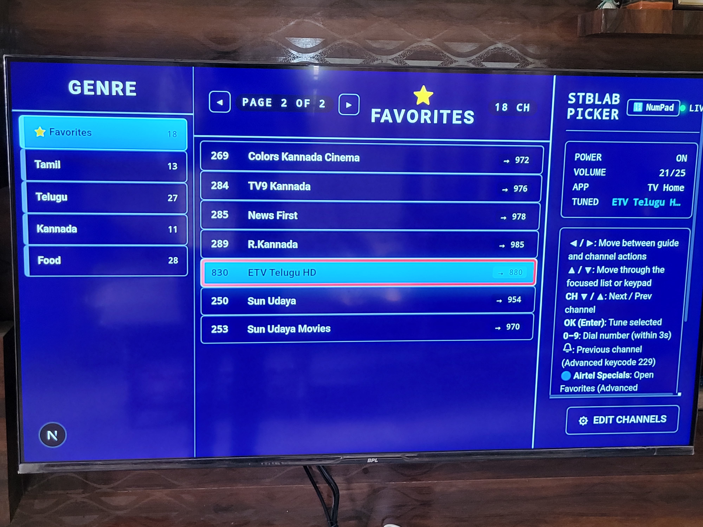
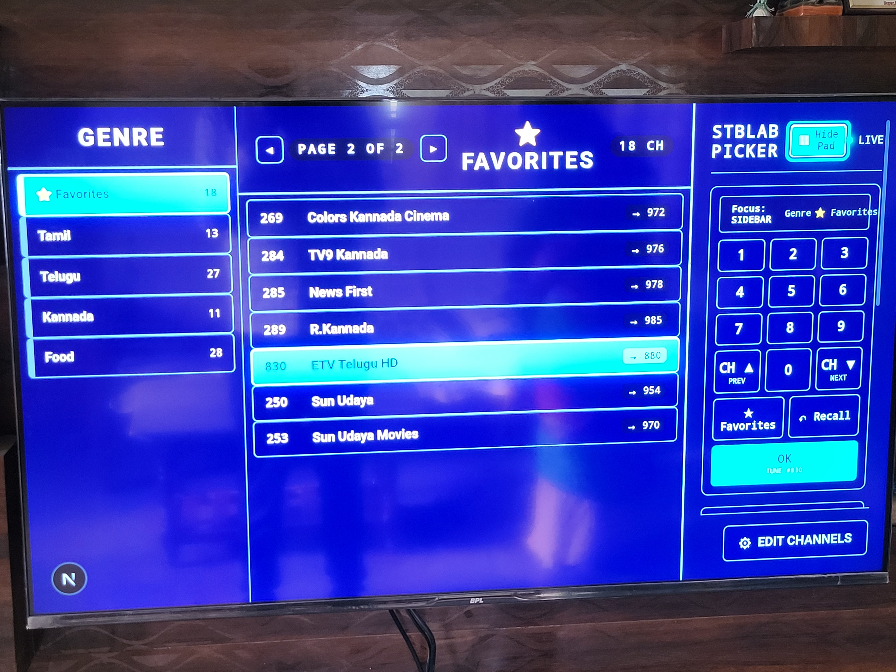
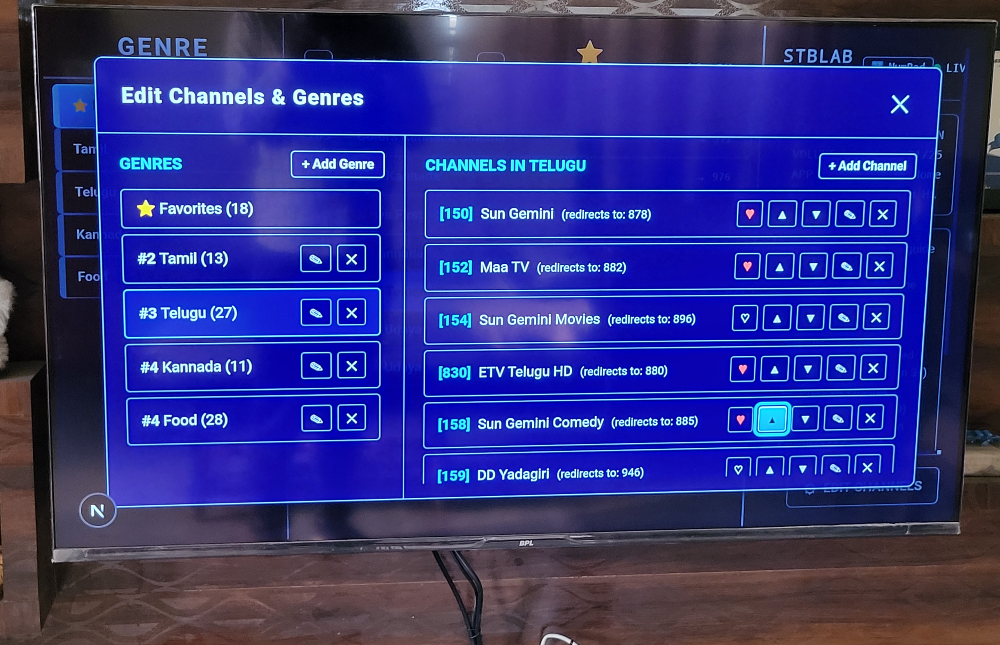

# StbLab

StbLab lets you browse and tune an Airtel Xstream TV channel guide, and control the set-top box with Android TV Remote v2. This repository contains three ways to run it, from a laptop-hosted web remote to native Android TV apps.

## Choose a setup

| Folder | Setup | How it works | Download |
| --- | --- | --- | --- |
| [`method-1_laptop`](https://github.com/bharathraj0643/stblab-phone-or-tv) | Laptop and browser | Runs the backend on a laptop. Open the web page from a phone or TV browser on the same network. | [releases](https://github.com/bharathraj0643/stblab/releases) |
| [`method-2_phone-or-tv`](https://github.com/bharathraj0643/stblab-phone-or-tv) | Android host | Runs the backend on android host and remote client on any browser tv or phone. | [releases](https://github.com/bharathraj0643/stblab-phone-or-tv/releases) |
| [`method-3_gui-recommended-method`](https://github.com/bharathraj0643/stblab-gui) | Native Android TV app | Runs the picker and remote controls directly as a native Android app, without a LAN web server or browser. intended to be used on android tv only, although it runs on android phone too, but ui controls are designed for a tv remote. | [releases](https://github.com/bharathraj0643/stblab-gui/releases) |

See each method's README for its prerequisites, pairing steps, build instructions, and current limitations.

  
  
  

## Common notes

- The Android TV Remote v2 pairing flow requires access to the TV screen to enter the code it displays.
- The laptop and Android host setups require the client/browser and Airtel box to be reachable on the same local network.
- The project has been tested with an Airtel Xstream set-top box. See the method-specific documentation for device and firmware details.
- Use the software only with devices you own or are authorized to control.

## Credits

The project builds on ideas and protocol work from [StbLab](https://github.com/Harsh3341/stblab) and [xstream-remote](https://github.com/Vijayapardhu/xstream-remote). The relevant method documentation includes additional attribution and license details.

 [Fully Kiosk Browser](https://play.google.com/store/apps/details?id=de.ozerov.fully) : best browser for tv remote navigation for this purpose of changing channels, use this browser on Android tv.

  [tvQuickActions](https://play.google.com/store/apps/details?id=dev.vodik7.tvquickactions.free&pcampaignid=web_share) : use this to map advanced keycodes for Favorites button, recall previous channel button, quick launch this website from the option key button all from the physical Airtel Remote.

  [atvtools on phone](https://play.google.com/store/apps/details?id=dev.vodik7.atvtools&pcampaignid=web_share) : it can be used for installing android apk on tv (since airtel box is locked), via tv adb option.

