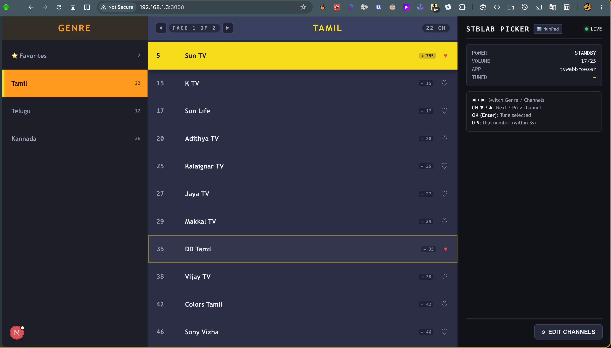
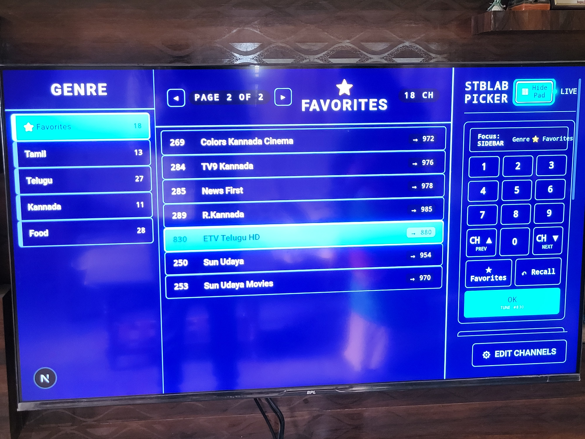
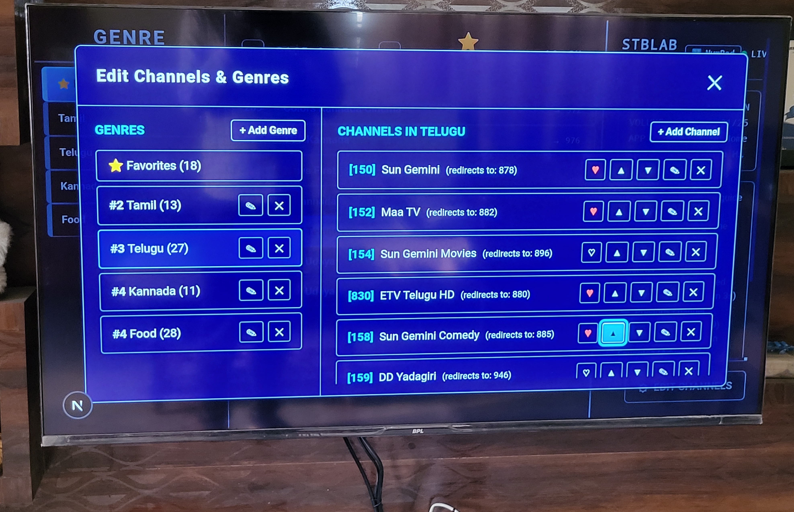

<div align="center">
  
  <h1>StbLab</h1>
  <p>
    Control an Android TV set-top box from your laptop — a from-scratch C# implementation of the
    Android TV Remote v2 protocol, an ASP.NET Core API on top of it, and a Next.js remote in the browser.
  </p>

credit : 
    - [https://github.com/Harsh3341/stblab](https://github.com/Harsh3341/stblab)

  -[https://github.com/Vijayapardhu/xstream-remote](https://github.com/Vijayapardhu/xstream-remote)

  
  Note : someone should take my project and make the server and client directly on mobile itself.
  
  [Fully Kiosk Browser](https://play.google.com/store/apps/details?id=de.ozerov.fully) : best browser for tv remote navigation for this purpose of changing channels, use this browser on Android tv
</div>


<p align="center">
  
  
  
</p>

A physical remote is a small infrared or Bluetooth keyboard. Everything it does is a key event, and
everything a set-top box shows you — power state, foreground app, volume — is state the box already
publishes over its own network protocol. This project speaks that protocol directly, so the remote can
be a web page.

No rooted device, no ADB, no manufacturer SDK. It pairs the same way the official Android TV remote app
does, and after that one-time step the box treats it as a normal remote.

## Why this exists

well airtel has no custom order of making favorites channels


**Features are a negotiated bitmask.** The device replies to `remote_configure` with the subset it
supports, and the client intersects its request with that.

| Flag | Value | |
| --- | --- | --- |
| `PING` | 1 | keepalive |
| `KEY` | 2 | key events |
| `IME` | 4 | text injection |
| `VOICE` | 8 | voice search |
| `POWER` | 32 | power state |
| `VOLUME` | 64 | volume state |
| `APP_LINK` | 512 | app launch |

This project requests 615 (`PING | KEY | IME | POWER | VOLUME | APP_LINK`). A device that narrows that
set is telling you which buttons will silently do nothing.

Important i found live button trigers Key 170 from the credit android project which i mentioned earlier


## Repository layout

```
proto/                       wire definitions
  polo.proto                 flattened OuterMessage + pairing messages
  remotemessage.proto        key events, IME, volume, app link
src/
  StbLab.Protocol/           the protocol itself — no ASP.NET, no dependencies beyond protobuf
    Framing.cs               varint length-delimited framing
    Certificates.cs          client certificate loading and public-number extraction
    CertificateFactory.cs    self-signed certificate generation for pairing
    PairingClient.cs         the pairing handshake and secret derivation
    RemoteClient.cs          the command channel: connect, send keys/text, track state
    KeyCodes.cs              key-name resolution over the generated enum
  StbLab.Cli/                a console client, useful for pairing and for scripting
  StbLab.Api/                ASP.NET Core HTTP API over the protocol
web/                         Next.js remote UI
```

The protocol project has no ASP.NET dependency, so you can reference it from a console app, a
background service, or anything else without dragging a web server along.

## Getting started (youtube help take)
you need to assign laptop(server) wifi connect as (windows/linux/mac)os wifi setting to your liking static ip like 192.168.1.55 (so 55 is the laptop server)

like wise in airtel set up box, wifi connect as (in android airtel setup box system os settings) to your liking static ip like 192.168.1.56 (so 56 is the tv browser clinet)

download `"tv broswer"` app on airtel setup box, and open website http://192.168.1.55:3000/ to see picker ui (55 we are opening on tv)

on the website long press ok button to turn on direct navigation instead of virtual cursor web navigation.

**Prerequisites.** .NET 10 SDK, and Node.js 20+ for the web UI. You also need a device on the same
network, and the ability to see its screen — pairing needs a code that it displays.

**1. Pair.** This generates a client certificate, runs the handshake, and prompts for the code shown on
the TV:

```bash
dotnet run --project src/StbLab.Cli -- pair
```

Credentials are written to `~/stb-lab/` by default. Override with `--dir <path>` or the `STB_LAB_DIR`
environment variable. The CLI defaults to `192.168.1.128` — pass `--host <ip>` to change it.

```bash
dotnet run --project src/StbLab.Cli -- --host 192.168.1.50 pair
```

**2. Point the API at the device.** Edit `src/StbLab.Api/appsettings.json`:

```jsonc
{
  "Stb": {
    "Host": "192.168.1.128",              // <- your device (TV)
    "CertificatePath": "../../../stb-lab-db/client_cert.pem", 
    "PrivateKeyPath": "../../../stb-lab-db/client_key.pem"
  }
}
```

**3. Run it.**

```bash
dotnet run --project src/StbLab.Api                              # http://127.0.0.1:5080

cd web && npm install && npm run dev                             # http://localhost:3000
```

The web app proxies `/api/*` to the API, so the browser only ever talks to one origin and there is no
CORS to configure.

**Using it from your phone.** The web app binds to every interface, so `http://<your-laptop-ip>:3000`
works from any device on the same network — which is where a remote is actually useful. Two things to
know:


## CLI

```
stb [--host <ip>] [--dir <path>] <command> [args]

  state                              connection, power, app, volume, identity
  key <NAME> [SHORT|START_LONG|END_LONG]
  text <message>                     type into the focused field
  launch <package|link>              open an app
  keys                               list every key name
  pair [code]                        pair, or complete pairing with a known code
```


## Compatibility

Built and verified against:

| | |
| --- | --- |
| Device | Airtel Xstream set-top box |
| Model | `XstreamIPTV1-VT` (Vantiva UIW4078ATL) |
| SoC | Amlogic S905Y5 |
| Firmware | `7.00.956317615` |
| Android | Google TV / Cast build `3.72.446070` |

The protocol is Google's, so this should work on any Android TV or Google TV device that exposes the
remote service on 6466 and 6467 — NVIDIA Shield, Chromecast with Google TV, and most television sets
running Android TV. If you try it on something else, a note about which model and firmware is welcome.

## Legal

This is a reverse-engineered client for a protocol that is not publicly documented. It exists for
interoperability and research on hardware the author owns. The pairing handshake requires physical
access to the device and a code the device itself displays, so it cannot be used to reach a device you
do not already control.

Use it on your own equipment. Do not use it to access devices you are not authorised to access.

## License

[MIT](LICENSE).
